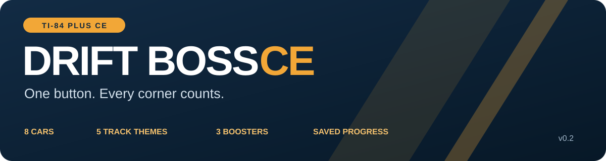
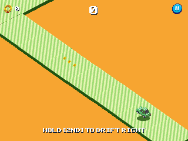
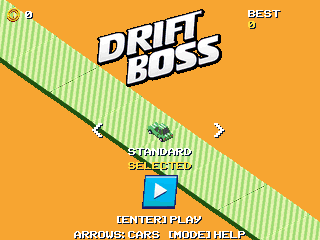
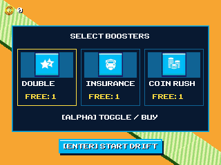
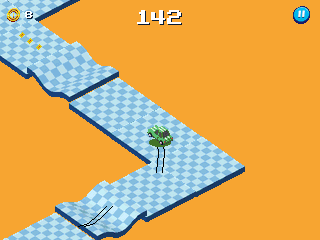
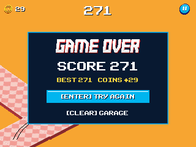

<p align="center">
  <a href="https://github.com/Lord-Funion/DriftBossCE/releases/latest">Download v0.2</a> ·
  <a href="docs/INSTALL.md">Installation</a> ·
  <a href="docs/BUILD.md">Build from source</a> ·
  <a href="https://github.com/Lord-Funion/DriftBossCE/issues">Report a bug</a>
</p>

**Hold to drift right. Release to drift left. Stay on the road.**

Drift Boss CE brings the one-button drifting game to the **TI-84 Plus CE** with original converted artwork, an eight-car garage, changing track themes, coins, boosters, and saved progress. Turn early: the car carries momentum through every switch.



*Deterministic captures of the compiled native renderer using scripted inputs in a CPU-only CEmu harness. GIFs are exported at 10 FPS; they are not hardware recordings or performance measurements.*

## What’s in the game

- **Eight vehicles** with unlock prices and handling progression: Standard, Pickup, Taxi, Police, Box Truck, Ice Cream, Ambulance, and Fire Truck.
- **Ten track-pattern generators**, both directions, and **five surface themes**.
- Ramps, bumps, valleys, narrow sections, split roads, and increasing difficulty.
- Coins and three boosters: **Double Score**, **Car Insurance**, and **Coin Rush**.
- Garage, pause/help screens, retry flow, and saved best score, cars, coins, and booster stock.
- Native C/eZ80 execution, fixed-point movement, and cached RLET graphics.

<table>
<tr><td></td><td></td></tr>
<tr><td align="center">Build your garage</td><td align="center">Choose your boosters</td></tr>
<tr><td></td><td></td></tr>
<tr><td align="center">Keep the run alive</td><td align="center">Beat your best</td></tr>
</table>

## Install

Download the **Cemetech ZIP** or **all-in-one `.b84` bundle** from [Releases](https://github.com/Lord-Funion/DriftBossCE/releases/latest). The ZIP includes the game, all graphics banks, runtime libraries, source, instructions, screenshots, and GIFs.

1. Use **TI Connect CE** to transfer the `.b84` bundle, or send all eight `.8xp` / `.8xv` files in `Calculator/`.
2. Keep the program, graphics banks, and libraries **archived**.
3. Launch **`DRIFTB`** through **CEaShell** with a working native C/ASM setup.

Tested by the project’s calculator owner on a **TI-84 Plus CE Python, OS 5.8.3, using CEaShell**. The reported gameplay speed was about **22 FPS** on that calculator; performance varies. This is a native program, not a calculator Python script. No OS update or ROM is included.

Allow roughly **214 KiB of archive** for all eight transfer files and at least **60 KiB free user RAM**. If upgrading from v0.1, replace only `DRIFTB.8xp`; keep the unchanged graphics banks, libraries, and **`DBSAVE`**. [Detailed installation and troubleshooting →](docs/INSTALL.md)

## Controls

| Screen | Control | Action |
|---|---|---|
| Driving | Hold **2nd** or **Enter** | Drift right |
| Driving | Release | Drift left |
| Driving | **Mode** or **Clear** | Pause |
| Garage / boosters | **Left / Right** | Browse |
| Garage / boosters | **Alpha** | Select, purchase, or toggle |
| Menus / retry | **2nd / Enter** | Continue |
| Paused | **2nd / Enter** | Resume |
| Paused | **Clear** | Return to garage |
| Garage | **Mode** | Help |
| Garage | **Clear** | Quit and save |

**Save by quitting from the garage with Clear.** Preserve `DBSAVE` to keep your progress.

## Build and test

The complete native project and generated asset banks are in this repository. Install [CE C/C++ Toolchain v15.0](https://github.com/CE-Programming/toolchain/releases/tag/v15.0), add `CEdev/bin` to `PATH`, and run:

```sh
make
python tools/build_assets.py
python tools/verify_release.py --built bin/DRIFTB.8xp
```

The first command produces `bin/DRIFTB.8xp`; the second recreates `DBAS0`, `DBAS1`, and `DBAS2` from the supplied binary banks. The verification command checks the packaged transfer files and compares the rebuilt program’s variable payload with the tested release.

The host regression test needs a C compiler:

```sh
cc -std=c11 -O2 -Isrc tests/test_core.c src/game.c -o core-tests
./core-tests
```

[Build guide and project layout →](docs/BUILD.md) · [Validation and performance →](docs/VALIDATION.md)

## Scope

This is an **unofficial native adaptation**, not the unchanged browser executable. The original Babylon.js/WebGL/Cannon stack is replaced with fixed-point movement, simplified contact physics, and pre-rendered original models viewed with an orthographic camera. Sliding, collision, ramps, jumps, lighting, and animation can differ. Audio, ads, smoke effects, and daily/random rewards are not included. Rendering targets a 30 FPS cap; it does not guarantee 30 FPS.

Original game and artwork: **MarketJS**. Reference version: [Math Playground’s Drift Boss](https://www.mathplayground.com/pg_drift_boss.html). Native calculator adaptation and release maintenance: **Lord-Funion**, with development assistance from Codex. Toolchain and libraries: **CE Programming**. Emulator core used for validation/media: **CEmu**.

Source is available for inspection and builds; no blanket open-source license is claimed for the code and original assets. Read [LICENSE.md](LICENSE.md) and [CREDITS.md](CREDITS.md) for the component-specific notices.
